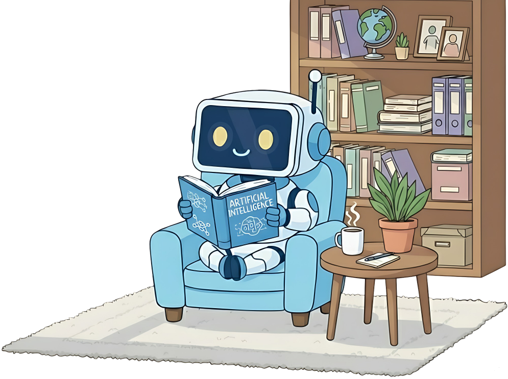
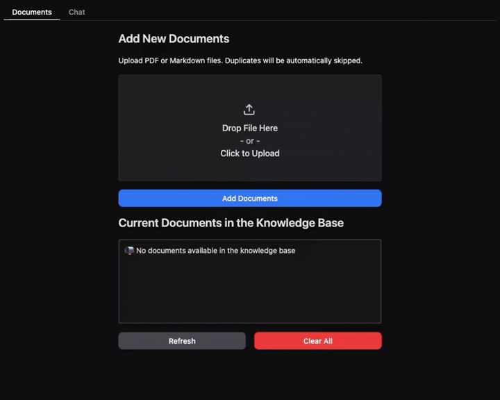

<p align="center">

</p>

<h1 align="center">AI Agentic RAG system - 1</h1>

<p align="center">
  <strong>Production-ready Agentic RAG system with LangGraph, conversation memory, and human-in-the-loop query clarification</strong>
</p>

<p align="center">
  <a href="#overview">Overview</a> •
  <a href="#how-it-works">How It Works</a> •
  <a href="#llm-provider-configuration">LLM Providers</a> •
  <a href="#implementation">Implementation</a> •
  <a href="#installation--usage">Installation & Usage</a> •
  <a href="#troubleshooting">Troubleshooting</a>
</p>

<p align="center">
  
</p>

<p align="center">
  <strong>If you like this project, a star ⭐️ would mean a lot :)</strong>
</p>

<p align="center" style="line-height: 1.6;">
  <em>✨ <strong>New:</strong></em><br>
  <em>• Multi-Agent Map-Reduce architecture for parallel query processing</em><br>
  <em>• Comprehensive PDF → Markdown conversion guide, including tool comparisons and VLM-based approaches</em><br>
  <em>• End-to-end Gradio interface for a complete interactive RAG pipeline</em>
</p>

## Overview

This repository demonstrates how to build an **Agentic RAG (Retrieval-Augmented Generation)** system using LangGraph with minimal code. It implements:

- 💬 **Conversation Memory**: Maintains context across multiple questions for natural dialogue
- 🔄 **Query Clarification**: Automatically rewrites ambiguous queries or asks for clarification
- 🔍 **Hierarchical Indexing**: Search small, specific chunks (Child) for precision, retrieve larger Parent chunks for context
- 🤖 **Agent Orchestration**: Uses LangGraph to coordinate the entire workflow
- 🧠 **Intelligent Evaluation**: Assesses relevance at the granular chunk level
- ✅ **Self-Correction**: Re-queries if initial results are insufficient
- 🔀 **Multi-Agent Map-Reduce**: Decomposes queries into parallel sub-queries for comprehensive answers

---

## How It Works

### Document Preparation: Hierarchical Indexing

Before queries can be processed, documents are split twice for optimal retrieval:

- **Parent Chunks**: Large sections based on Markdown headers (H1, H2, H3)
- **Child Chunks**: Small, fixed-size pieces derived from parents

This approach combines the **precision of small chunks** for search with the **contextual richness of large chunks** for answer generation.

---

### Query Processing: Four-Stage Intelligent Workflow
```
User Query → Conversation Analysis → Query Clarification →
Agent Reasoning → Search Child Chunks → Evaluate Relevance →
(If needed) → Retrieve Parent Chunks → Generate Answer → Return Response
```

#### Stage 1: Conversation Understanding
- Analyzes recent conversation history to extract context
- Maintains conversational continuity across multiple questions

#### Stage 2: Query Clarification

The system intelligently processes the user's query:
1. **Resolves references** - Converts "How do I update it?" → "How do I update SQL?"
2. **Splits complex questions** - Breaks multi-part questions into focused sub-queries
3. **Detects unclear queries** - Identifies nonsense, insults, or vague questions
4. **Requests clarification** - Uses human-in-the-loop to pause and ask for details
5. **Rewrites for retrieval** - Optimizes query with specific, keyword-rich language

#### Stage 3: Intelligent Retrieval

**Multi-Agent Map-Reduce Architecture:**

When the query analysis stage identifies multiple distinct questions (either explicitly asked or decomposed from a complex query), the system automatically spawns parallel agent subgraphs using LangGraph's `Send` API. Each agent independently processes one question through the full retrieval workflow:

1. Agent searches child chunks for precision
2. Evaluates if results are sufficient
3. Fetches parent chunks for context if needed
4. Extracts final answer from conversation
5. Self-corrects and re-queries if insufficient

All agent responses are then aggregated into a unified answer.

**Example:** *"What is JavaScript? What is Python?"* → 2 parallel agents execute simultaneously

**Single question workflow:**
For simple queries, a single agent executes the retrieval workflow without parallelization.

#### Stage 4: Response Generation

The system synthesizes information from retrieved chunks (or multiple agents) into a coherent, accurate answer that directly addresses the user's question.

---

## LLM Provider Configuration

This system is **provider-agnostic** - you can use any LLM supported by LangChain. Choose the option that best fits your needs:

### Ollama (Local - Recommended for Development)

**Install Ollama and download the model:**

```bash
# Install Ollama from https://ollama.com
ollama pull qwen3:4b-instruct-2507-q4_K_M
```

**Python code:**

```python
from langchain_ollama import ChatOllama

llm = ChatOllama(model="qwen3:4b-instruct-2507-q4_K_M", temperature=0)
```

---

### Google Gemini (Cloud - Recommended for Production)

**Install the package:**

```bash
pip install -qU langchain-google-genai
```

**Python code:**

```python
import os
from langchain_google_genai import ChatGoogleGenerativeAI

# Set your Google API key
os.environ["GOOGLE_API_KEY"] = "your-api-key-here"
llm = ChatGoogleGenerativeAI(model="gemini-2.0-flash-exp", temperature=0)
```

---

### OpenAI / Anthropic Claude

<details>
<summary>Click to expand</summary>

**OpenAI:**
```bash
pip install -qU langchain-openai
```
```python
from langchain_openai import ChatOpenAI
import os

os.environ["OPENAI_API_KEY"] = "your-api-key-here"
llm = ChatOpenAI(model="gpt-4o-mini", temperature=0)
```

**Anthropic Claude:**
```bash
pip install -qU langchain-anthropic
```
```python
from langchain_anthropic import ChatAnthropic
import os

os.environ["ANTHROPIC_API_KEY"] = "your-api-key-here"
llm = ChatAnthropic(model="claude-3-5-sonnet-20241022", temperature=0)
```

</details>

---

### Important Notes

- **All providers** work with the exact same code - only the LLM initialization changes
- **Cost considerations:** Cloud providers charge per token, while Ollama is free but requires local compute

---

## Modular Architecture

The app (`project/` folder) is organized in modular components that can be easily customized:

### 📂 Project Structure
```
project/
├── app.py                    # Main Gradio application entry point
├── config.py                 # Configuration hub (models, chunk sizes, providers)
├── util.py                   # PDF to markdown conversion
├── document_chunker.py       # Chunking strategy
├── core/                     # Core RAG components orchestration
│   ├── chat_interface.py     
│   ├── document_manager.py   
│   └── rag_system.py         
├── db/                       # Storage management
│   ├── parent_store_manager.py  # Parent chunks storage (JSON)
│   └── vector_db_manager.py     # Qdrant vector database setup
├── rag_agent/                # LangGraph agent workflow
│   ├── edges.py              # Conditional routing logic
│   ├── graph.py              # Graph construction and compilation
│   ├── graph_state.py        # State definitions
│   ├── nodes.py              # Processing nodes (summarize, rewrite, agent)
│   ├── prompts.py            # System prompts
│   ├── schemas.py            # Pydantic data models
│   └── tools.py              # Retrieval tools
└── ui/                       # User interface
    └── gradio_app.py         # Gradio interface components
```

### Full Python Project Setup

#### 1. Install Dependencies

```bash
# Clone the repository
git clone <repo-url>
cd agentic-rag-for-dummies

# Create virtual environment (recommended)
python -m venv venv

# Activate it
# On macOS/Linux:
source venv/bin/activate
# On Windows:
.\venv\Scripts\activate

# Install packages
pip install -r requirements.txt
```

#### 2. Run the Application

```bash
python app.py
```

#### 3. Ask Questions

Open the local URL (e.g., `http://127.0.0.1:7860`) to start chatting.

---

### Option 3: Docker Deployment 

> ⚠️ **System Requirements**: Docker deployment requires **at least 8GB of RAM** allocated to Docker. The Ollama model (`qwen3:4b-instruct-2507-q4_K_M`) needs approximately 3.3GB of memory to run.

#### Prerequisites

- Docker installed on your system ([Get Docker](https://docs.docker.com/get-docker/))
- Docker Desktop configured with at least 8GB of RAM (Settings → Resources → Memory)

#### 1. Build the Docker Image

```bash
docker build -f project/Dockerfile -t agentic-rag .
```

#### 2. Run the Container

```bash
docker run --name rag-assistant -p 7860:7860 agentic-rag
```

> ⚠️ **Performance Note**: Docker deployment may be 20-50% slower than running Python locally, especially on Windows/Mac, due to virtualization overhead and I/O operations. This is normal and expected. For maximum performance during development, consider using Option 2 (Full Python Project).

**Optional: Enable GPU acceleration** (NVIDIA GPU only):

If you have an NVIDIA GPU and [NVIDIA Container Toolkit](https://docs.nvidia.com/datacenter/cloud-native/container-toolkit/install-guide.html) installed:

```bash
docker run --gpus all --name rag-assistant -p 7860:7860 agentic-rag
```

**Common Docker commands:**

```bash
# Stop the container
docker stop rag-assistant

# Start an existing container
docker start rag-assistant

# View logs in real-time
docker logs -f rag-assistant

# Remove the container
docker rm rag-assistant

# Remove the container forcefully (if running)
docker rm -f rag-assistant
```

#### 3. Access the Application

Once the container is running and you see:
```
🚀 Launching RAG Assistant...
* Running on local URL:  http://0.0.0.0:7860
```

Open your browser and navigate to:
```
http://localhost:7860
```

### Example Conversations

**With Conversation Memory:**
```
User: "How do I install SQL?"
Agent: [Provides installation steps from documentation]

User: "How do I update it?"
Agent: [Understands "it" = SQL, provides update instructions]
```

**With Query Clarification:**
```
User: "Tell me about that thing"
Agent: "I need more information. What specific topic are you asking about?"

User: "The installation process for PostgreSQL"
Agent: [Retrieves and answers with specific information]
```

---

## Troubleshooting

| Area | Common Problems | Suggested Solutions |
|------|----------------|------------------|
| **Model Selection** | - Responses ignore instructions<br>- Tools (retrieval/search) used incorrectly<br>- Poor context understanding<br>- Hallucinations or incomplete aggregation | - Use more capable LLMs<br>- Prefer models 7B+ for better reasoning<br>- Consider cloud-based models if local models are limited |
| **System Prompt Behavior** | - Model answers without retrieving documents<br>- Query rewriting loses context<br>- Aggregation introduces hallucinations | - Make retrieval explicit in system prompts<br>- Keep query rewriting close to user intent<br>- Enforce strict aggregation rules |
| **Retrieval Configuration** | - Relevant documents not retrieved<br>- Too much irrelevant information | - Increase retrieved chunks (`k`) or lower similarity thresholds to improve recall<br>- Reduce `k` or increase thresholds to improve precision |
| **Chunk Size / Document Splitting** | - Answers lack context or feel fragmented<br>- Retrieval is slow or embedding costs are high | - Increase chunk & parent sizes for more context<br>- Decrease chunk sizes to improve speed and reduce costs |
| **Temperature & Consistency** | - Responses inconsistent or overly creative<br>- Responses too rigid or repetitive | - Set temperature to `0` for factual, consistent output<br>- Slightly increase temperature for summarization or analysis tasks |
| **Embedding Model Quality** | - Poor semantic search<br>- Weak performance on domain-specific or multilingual docs | - Use higher-quality or domain-specific embeddings<br>- Re-index all documents after changing embeddings |
---

## License

MIT License - Feel free to use this for learning and building your own projects!

---

## Contributing

Contributions are welcome! Open an issue or submit a pull request!
